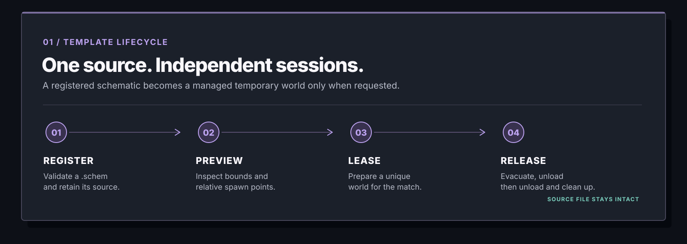
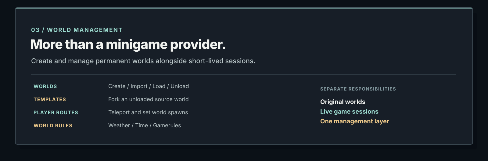

  

# VWorld 

**Build once. Give every match its own world.**

A good Minecraft arena takes time to build. You shouldn't have to start over each time another minigame needs it.

**VWorld** by **VACK STUDIO** brings everyday Paper world management together with reusable schematic templates. Keep your original build safe, let each game request an **independent temporary world**, and release that instance when its session is finished. **One creation, many possibilities — without sharing one live arena between matches.**

> [!IMPORTANT]
> **Private distribution.** VWorld is proprietary software by VACK STUDIO. This public repository is a project showcase; the source, integration documents and installable builds remain private. There is no public plugin download here.

## From one build to many matches 

**What if two games want the same map?** VWorld treats the saved `.schem` as a source, not as the live match. Each game can request its own temporary world through the provider API.

  

| Stage | What happens |
| --- | --- |
| **01 · Register** | Add a supported Sponge `.schem` v2/v3 from the server's file manager; VWorld validates it and records a template ID. |
| **02 · Preview** | Inspect the build in a temporary world. Save its bounds and important positions, such as spawn and spectator points. |
| **03 · Lease** | An integrating minigame requests its own temporary world. Each session has a separate world identity. |
| **04 · Release** | VWorld safely evacuates occupants, unloads and cleans up the owned world. Failed cleanup stays tracked for inspection or retry. |

**The boundary matters:** VWorld manages worlds and leases. Your minigame manages gameplay, inventories and the player's return to its lobby.

## Keep the original. Release the temporary. 

Your arena is more than a disposable folder. VWorld separates **registered source schematics** from **temporary match-owned worlds** — so cleanup knows what it actually owns.

  

| Protected by design | Why it matters |
| --- | --- |
| **Your source build** | VWorld checks the schematic before use; releasing a session doesn't overwrite or delete the source file. |
| **Your other worlds** | Unknown, unowned and protected worlds aren't automatically removed as temporary sessions. |
| **Your recovery options** | An unsafe unload, evacuation or deletion leaves the owned session available for inspection and retry. |

The result is a cleaner separation between what you want to **keep** and what a game is allowed to **release**.

## More than a minigame tool 

Need to create a fresh world? Bring an existing one online? Change the weather before an event? VWorld keeps those familiar administrative tools in the same place.

  

| Your world, your rules | Available tools |
| --- | --- |
| **Create & manage** | Create, import, load, unload and fork worlds. |
| **Move players** | Teleport between worlds and set spawn points. |
| **Set the scene** | Configure PvP, difficulty, mob spawning, time, weather and gamerules. |
| **Protect the important stuff** | Confirm deletion and respect protected-world restrictions. |

The familiar **`/vworld`** and **`/vw`** commands remain. Regular world management also works without WorldEdit; **the schematic provider requires it**.

## Mini Zoiila's setup tips 

**Before the first match, take a walk through your map like a player would.** A beautiful build is only the beginning — your game also needs sensible boundaries, safe spawn points and a clear place for spectators.

| Check | What to look for |
| --- | --- |
| **Spawn & spectate** | Preview the map, check the playable bounds and save the named points your game needs. |
| **Enter safely** | Use **Creative or Spectator** for previews. Void space can be present, so Survival preview entry is refused. |
| **Choose the right file** | Use supported Sponge `.schem` v2/v3. Legacy `.schematic`, `.litematic` and entity-bearing schematics aren't supported in this preview. |
| **Plan the exit** | Keep a loaded, safe evacuation world available and back up your worlds before upgrades. Never remove ownership markers to force cleanup. |

**Tip from Mini Zoiila:** *Preview the whole player journey, not just the build.* It's the little details that make a reusable arena feel ready for every new match.

## Requirements & availability

The documented target is **VWorld 1.1.0-preview.3**.

| Component | Requirement or status |
| --- | --- |
| Server | **Paper 26.2** — build 130 used in isolated validation |
| Java | **Java 25** |
| Schematic provider | Official **WorldEdit 7.4.6**, installed separately |
| Supported templates | Sponge **`.schem` v2/v3**, subject to size and content limits |
| Other implementations | **Leaf, Folia and FAWE not verified** |

This is a **development preview**, not a production-readiness claim. Isolated builds and provider tests were completed, but real-player acceptance, complete client UI checks and production performance profiling remain outstanding.

## Configuration & source examples

Want to explore VWorld beyond the showcase? These **documented examples** demonstrate real configuration keys, the template setup flow and the public-facing integration contract.

| Explore | What's inside |
| --- | --- |
| [Example configuration](examples/config.example.yml) | Protected worlds, default settings and schematic capacity limits |
| [Template setup guide](examples/template-workflow.md) | Actual commands to register, preview, mark and release a schematic |
| [Developer integration example](examples/consumer-integration.md) | Illustrative `WorldProvider` API usage, ownership responsibilities and source access |
| [All examples](examples/README.md) | A short index and important safety notes |

**About the source:** The plugin's actual Java implementation and production JARs remain private. The developer reference is an **illustrative code excerpt**, not the plugin source or a ready-to-run minigame adapter. YAML examples are for learning and should not overwrite a running server's saved files.

## Get VWorld

**VWorld is privately distributed by VACK STUDIO.** For product questions or licensing, use the studio links below. The [historical release notes](RELEASE_NOTES.md) cover an earlier 1.0.0 iteration, not a download for this preview.

---

  

  
  &nbsp;&nbsp;&nbsp;&nbsp;
  

<strong>License &amp; rights — VACK STUDIO</strong>

Copyright © 2026 VACK STUDIO. All rights reserved.

VWorld is a private-distribution project. Source code, installable builds and customer release files are not included in this public presentation repository. Third-party components retain their own licensing terms.

The example Grass Block in these diagrams uses Minecraft Java 26.2's original block textures; see [asset attribution](assets/MINECRAFT-ASSET-SOURCES.md).

