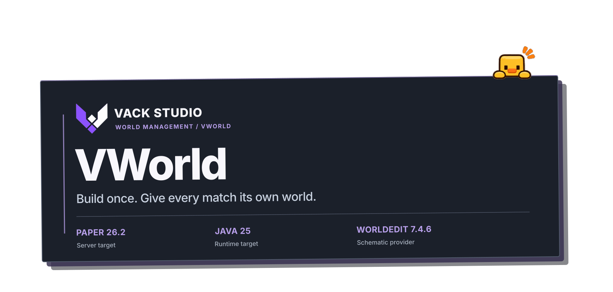
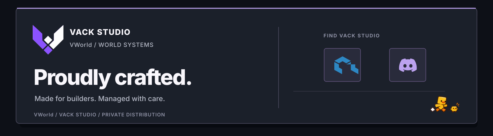

<p align="center">
  
</p>

# VWorld

**World management for Paper, with isolated schematic sessions for minigames.**

VWorld brings two jobs into one place: manage the worlds already on your server, and provision **temporary, independently owned worlds** from a reusable schematic when a game needs one. Keep the source template intact while each session gets its own world lifecycle.

> [!IMPORTANT]
> **Private distribution.** This public repository is VWorld's project showcase. Development source, technical integration documents and versioned JARs are maintained privately by **VACK STUDIO**. No public installer or source download is provided here.

## From template to game world

<p align="center">
  
</p>

The schematic provider is designed around a simple rule: **a template is a source, not a match**. Register a supported `.schem` once, inspect its boundaries and named points, and request an independent temporary world for each game session.

| Stage | What VWorld does |
| --- | --- |
| **Register** | Scan host-provided Sponge v2/v3 `.schem` files, validate them and record template metadata under a stable ID. |
| **Preview** | Open a temporary preview to inspect the pasted build and configure relative boundaries, spawn or spectator points. |
| **Provision** | Provide a separate temporary world through the service's request/lease workflow. Concurrent sessions do not share world UUIDs. |
| **Release** | Track the owned session through evacuation, unload and safe cleanup, retaining failed operations for inspection or retry. |

Source schematics remain unchanged. VWorld does **not** offer browser uploads, and the schematic provider does not support arbitrary file paths, `.schematic`, `.litematic` or entity-bearing schematics in this preview.

## Managed worlds, protected sources

<p align="center">
  
</p>

Temporary worlds need a clear owner and a safe exit. VWorld maintains session ownership information, preserves the original schematic bytes, and avoids deleting unknown or unowned worlds. If evacuation, unloading or cleanup is unsafe, the session is retained for investigation instead of pretending the removal succeeded.

A game integrating with VWorld is still responsible for its own **player inventory, match state and return flow**. VWorld manages the worlds and their owned leases; it does not magically replace game-specific lifecycle handling.

## Manage your existing worlds

<p align="center">
  
</p>

VWorld also includes the familiar `/vworld` and `/vw` world-administration commands. Administrators can create or import worlds, load and unload them, fork an unloaded world, manage protected deletion, set world spawns, teleport, and change properties such as PvP, weather, time and game rules.

| World administration | Available operations |
| --- | --- |
| **Lifecycle** | Create, import, load, unload and fork worlds |
| **Player movement** | Teleport to a world and set its spawn location |
| **Properties** | PvP, autosave, autoload, mobs, difficulty, time, weather and gamerules |
| **Protection** | Confirm destructive actions and protect configured worlds from unsafe deletion |

The existing commands remain available even without WorldEdit; **WorldEdit is required only for the schematic provider**.

## Getting started

The documented **VWorld 1.1.0-preview.3** targets the following environment:

| Component | Requirement or status |
| --- | --- |
| Server | **Paper 26.2** (build 130 used for isolated validation) |
| Java | **Java 25** |
| Schematic provider | Official **WorldEdit 7.4.6**, installed separately |
| Template format | Sponge `.schem` **v2 or v3** (supported subset) |
| Other server implementations | Leaf, Folia and FAWE **not verified** |

On a licensed installation, place the source file in `plugins/VWorld/schematics/`, then use the schematic management commands. These are genuine examples of the documented workflow, not an interactive client screenshot:

```text
/vworld worlds scan
/vworld worlds import MyArena arena.schem
/vworld worlds preview MyArena
/vworld worlds enter <session-uuid>
/vworld worlds release <session-uuid>
```

`preview` produces a session UUID for entering or releasing the temporary world. **Enter previews as Creative or Spectator**: VWorld refuses Survival entry to potentially unsafe void previews. Bounds and named points can be edited in a preview with the supported administrative tools.

> **Installation note:** Back up existing worlds and settings before changing VWorld versions. If upgrading from the legacy VackWorlds data folder, the plugin performs the documented safe-folder migration only when the destination is absent or empty. When both folders hold data, it stops rather than overwrite them.

## Preview and availability

**VWorld 1.1.0-preview.3** is a development preview, not a production-readiness guarantee. Build and isolated provider tests are documented privately; real-player acceptance, full client UI checks, multi-plugin combinations and production performance profiling remain outstanding.

The older [release notes](RELEASE_NOTES.md) describe a historical 1.0.0 iteration and should not be confused with the preview above. This public repository intentionally includes **no plugin binaries, private source or downloadable builds**.

---

<p align="center">
  
</p>

<p align="center">
  <a href="https://builtbybit.com/members/vack-studio.891381/#latest-activity" aria-label="BuiltByBit" title="BuiltByBit"></a>
  &nbsp;&nbsp;&nbsp;&nbsp;
  <a href="https://discord.gg/y45brtZBEE" aria-label="Discord" title="Discord"></a>
</p>

<details>
<summary><strong>Rights &amp; distribution — VACK STUDIO</strong></summary>

Copyright © 2026 VACK STUDIO. All rights reserved.

VWorld is privately distributed. The source code and binaries are not included in this public presentation repository. Third-party software remains subject to its respective licenses.

</details>
