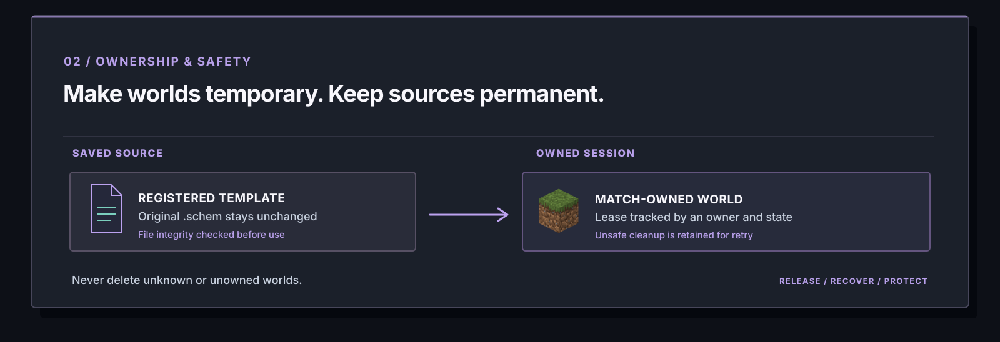

  

# VWorld 

**Build once. Give each game its own world.**

Think of the arena you've spent hours creating. Now imagine using that same build for separate minigame sessions **without handing every match the same world**. That's the idea behind **VWorld** by **VACK STUDIO**: a home for your existing Paper worlds, plus a schematic-based system for temporary, independently owned game worlds.

A source template stays a source. Each requested session has its own world and lifecycle. When a match is finished, VWorld can release the temporary instance without treating the original creation as disposable.

> [!IMPORTANT]
> **Private distribution.** This repository is the public VWorld showcase. The development source and installable builds remain private to VACK STUDIO. No public JAR or source-code download is provided here.

## How does one template power different games? 

  

**One build. More than one session.** VWorld keeps the source schematic separate from the worlds it prepares for matches. Here's what the documented workflow looks like:

| Step | What happens |
| --- | --- |
| **Register a template** | Import a supported Sponge **`.schem` v2/v3** supplied through the server's file manager. VWorld validates it and records a reusable template ID. |
| **Take a preview** | Inspect the build in a temporary preview world, then define relative bounds and named positions such as spawn and spectator points. |
| **Prepare a match world** | A game plugin can request an independent temporary world through VWorld's lease API. Sessions have distinct world identities. |
| **Release when finished** | VWorld evacuates occupants, unloads and cleans up only its owned instance when safe. If cleanup fails, it keeps the record for investigation or retry. |

You can build a map once and *reuse the schematic* without asking every live match to share one world. Different game plugins still control their own gameplay, inventories and player return behavior.

## Your original creations deserve protection

  

**The temporary world may come and go. Your source shouldn't.** VWorld tracks ownership rather than deleting folders simply because they look temporary. It checks schematic integrity before providing a session and preserves the original source files.

| VWorld protects | Why it matters |
| --- | --- |
| **Source templates** | Registered `.schem` files aren't overwritten or deleted by the session cleanup flow. |
| **Existing server worlds** | Protected or unowned worlds are outside automatic temporary-world cleanup. |
| **Interrupted sessions** | Unsafe evacuation, unloading or deletion leaves an inspectable session instead of silently discarding ownership. |

VWorld owns the *world lifecycle*, not your minigame's inventory system or match rules. The game integration remains responsible for players' saved state and their return to its own lobby.

## More than a template manager

  

VWorld also gives administrators the everyday tools to handle worlds already on the server. There's no need to prepare a schematic just to create a normal world, set its spawn or change its weather.

| What you manage | What VWorld offers |
| --- | --- |
| **Worlds** | Create, import, load, unload and fork unloaded source worlds |
| **Player routes** | Teleport between worlds and set world spawns |
| **World settings** | PvP, auto-saving, mob spawning, difficulty, time, weather and gamerules |
| **Safety controls** | Explicit confirmation for deletion and restrictions on protected worlds |

Its familiar `/vworld` and `/vw` command entry points remain available. **WorldEdit is only required for the schematic provider**, not the original whole-world management features.

## Preparing a better VWorld template

**Mini Zoiila's setup tips** 

Before you give a build to a minigame, open it in a preview and treat it like a real player would: check the usable building space, walk the spawn points, and make sure the spectator position is outside the active area. These small details make game worlds easier to reuse.

A few habits worth keeping:

- **Prepare safe preview entry.** Use Creative or Spectator: a preview may contain void, and Survival entry is deliberately refused.
- **Check the actual source.** Use supported Sponge v2/v3 `.schem` files. Don't assume legacy `.schematic`, `.litematic` or entity-bearing schematics will work.
- **Keep a safe exit available.** Configure an existing loaded evacuation world for temporary-world cleanup when appropriate.
- **Protect your work.** Back up your original worlds and settings; don't remove temporary ownership markers manually to force a cleanup.

## Compatibility and availability

The documented **VWorld 1.1.0-preview.3** targets:

| Component | Target |
| --- | --- |
| Server | **Paper 26.2** (build 130 used for isolated checks) |
| Java | **Java 25** |
| Schematic provider | **WorldEdit 7.4.6**, installed separately |
| Supported schematic input | **Sponge `.schem` v2/v3**, within the documented limits |
| Other implementations | **Leaf, Folia and FAWE not verified** |

The preview has undergone isolated build and provider checks, but **real-player acceptance, complete GUI checks and production profiling remain pending**. That's a preview limitation, not a feature claim.

**VWorld is privately distributed by VACK STUDIO.** The [historical release notes](RELEASE_NOTES.md) describe an earlier 1.0.0 version, not a public download of this preview. For product questions or licensing, use the studio's official links below.

---

  

  
  &nbsp;&nbsp;&nbsp;&nbsp;
  

<strong>License &amp; rights — VACK STUDIO</strong>

Copyright © 2026 VACK STUDIO. All rights reserved.

VWorld is a private-distribution project. Source code, installable builds and customer release files are not included in this public presentation repository. Third-party components retain their own licensing terms.

The example Grass Block in these diagrams uses Minecraft Java 26.2's original block textures; see [asset attribution](assets/MINECRAFT-ASSET-SOURCES.md).

